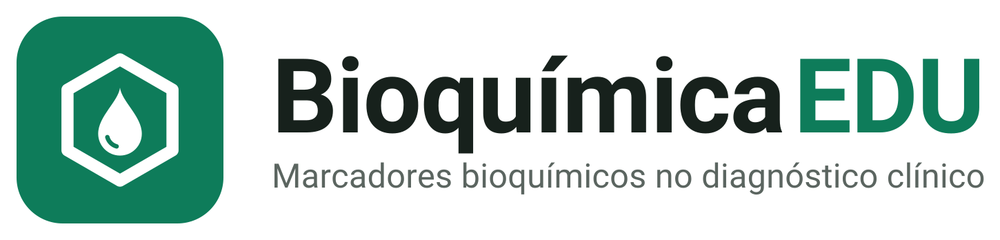

<p align="center">
  
</p>

<p align="center">
  <strong>Bioquímica clínica no ritmo da sua memória.</strong><br>
  App gratuito para estudar marcadores bioquímicos, para computador, tablet e celular.<br>
  Projeto de iniciação científica · UNICID · PIBIC/CNPq
</p>

<p align="center">
  <a href="https://bioquimicaedu.web.app"><strong>Baixar em bioquimicaedu.web.app</strong></a>
</p>

---

<p align="center">
  
  
</p>

## O que é

O BioquímicaEDU ajuda estudantes da área da saúde a aprender e a não esquecer
faixas de referência e a interpretação de exames laboratoriais. Ele aplica duas
estratégias com evidência científica: tentar lembrar antes de ver a resposta e
revisar em intervalos que crescem com o tempo (revisão espaçada).

É o resultado do projeto *Desenvolvimento de software educacional para o ensino
interativo de bioquímica clínica: marcadores bioquímicos e sua correlação com
doenças*, de Alexandro de Araujo Junior, com orientação do Prof. Dr. Francisco
de Assis Cavallaro (Universidade Cidade de São Paulo, PIBIC/CNPq).

## Recursos

- **22 marcadores em 6 sistemas** (hepático, renal, glicêmico, lipídico,
  eletrólitos e equilíbrio ácido-base, cardíaco), com faixa de referência,
  interpretação, condições associadas, exemplos clínicos, fontes e vídeos.
  Inclui uma **calculadora da TFG estimada** (CKD-EPI 2021, categorias da KDIGO).
- **Revisão espaçada** com o algoritmo SM-2 adaptado: o app escolhe o que revisar
  a cada dia, e "Difícil", "Bom" e "Fácil" levam a intervalos diferentes.
- **Prática:** 59 cards, quiz de 10 questões sorteadas de 14, 15 casos clínicos
  e dois jogos ("Alto, normal ou baixo?" e jogo da memória). Tudo alimenta a revisão.
- **Autoavaliação:** antes de ver a resposta, o estudante diz o quanto acha que sabe,
  e o app compara com os acertos.
- **Tutor**, em ordem de preferência: Gemini (pela internet; já vem ligado no
  `.exe` e no APK do site), modelo local com o Ollama (opcional, só no computador)
  e a base do próprio app, que responde sempre, sem internet. Valores e
  interpretações vêm sempre do conteúdo curado do app.
- **Acessibilidade:** texto até 150%, alto contraste, fonte Atkinson Hyperlegible,
  leitura em voz alta, atalho para Libras (VLibras) e modo foco.
- **Conta Google opcional**, só para lembrar se a apresentação inicial já foi vista.
  O progresso de estudo fica sempre no aparelho.

O conteúdo usa obras de referência com acesso conferido (StatPearls, Manual MSD,
diretriz KDIGO 2024 e artigos com DOI). É material de apoio ao estudo: não serve
para diagnóstico nem para decidir conduta com pacientes.

## Baixar

Pelo site **https://bioquimicaedu.web.app** (versão atual: 0.6):

| Sistema | Como |
|---|---|
| Windows 10 ou 11 (64 bits) | arquivo `.exe`, que abre sem precisar instalar; na primeira vez, o Windows pode mostrar um aviso, porque o app não tem assinatura digital paga |
| Android 5.0 ou mais recente (64 bits) | arquivo `.apk`, instalado fora da Play Store |
| macOS e Linux | pelo código-fonte (abaixo) |
| iPhone e iPad | não disponível |

## Rodar a partir do código

Com Python 3.11 ou 3.12:

```bash
pip install -r requirements.txt
python main.py              # o app, que se adapta ao tamanho da janela
python main.py --celular    # o mesmo app em formato de celular
python main.py --classico   # versão antiga para computador, em Tkinter
python main_enhanced.py     # versão antiga com tutor local (Ollama, opcional)
```

Sem configurar nada, o app funciona por completo, sem login com Google e com o
tutor respondendo pela base do app. Para ligar os recursos de nuvem:

- tutor com Gemini: [docs/TUTOR_GEMINI.md](docs/TUTOR_GEMINI.md);
- login com Google: [docs/LOGIN_GOOGLE.md](docs/LOGIN_GOOGLE.md).

O progresso fica em `data/` quando o app roda pelo código, em
`%APPDATA%\BioquimicaEDU` no `.exe` do Windows e, no Android, na pasta privada do
app (atualizar o APK não apaga o que já foi estudado).

## Testes

Cada arquivo roda sozinho, numa pasta temporária: o progresso real não é lido
nem alterado.

```bash
python test_kivy_completo.py   # percorre todas as telas do app
python test_progresso.py       # motor de revisão espaçada e arquivo de progresso
python test_conteudo.py        # conteúdo: marcadores da proposta, fontes, casos, calculadora
python test_jogos.py           # regras dos jogos
python test_tutor.py           # tutor com Gemini simulado e servidor do tutor
python test_login.py           # login com Google simulado
python test_desktop.py         # versões clássicas para computador
```

## Gerar o `.exe` e o APK

- **Windows:** `pyinstaller empacotamento/bioquimicaedu_windows.spec` gera um
  executável único, que abre sem instalar. O spec deixa de fora o `.env`, o
  progresso e a sessão de quem gera.
- **Android:** o APK é gerado pelo GitHub Actions (`.github/workflows/android.yml`),
  com Buildozer ([docs/ANDROID.md](docs/ANDROID.md)), e conferido por
  `empacotamento/conferir_apk.py`.
- Os dois vão para as versões (Releases) do
  [repositório do site](https://github.com/Alexandro-Junior/Site-Bioqu-micaEDU).

## Estrutura

```
main.py                ponto de entrada (no Android também); com --classico,
                       a versão clássica em Tkinter
mobile/                o app em Kivy: telas, componentes, tema, conta, voz
progresso.py           motor de aprendizagem (SM-2 adaptado) e progresso
jogos.py, calculos.py  regras dos jogos e calculadora da TFG estimada
assistente.py          tutor: Gemini, Ollama e base do app
autenticacao.py        login com Google pelo Firebase
painel_inicio.py,      telas das versões clássicas para computador (Tkinter);
tela_*.py, ollama_ia.py  ollama_ia.py é o tutor local de main_enhanced.py
criar_*.py             geram a logo, o ícone, os diagramas e as capturas do site
servidor/              servidor intermediário do tutor (Cloudflare Workers)
data/                  conteúdo: marcadores, cards, quiz, casos, fontes, diagramas
assets/                logo, ícone, tela de abertura e fontes
firebase/              regras do banco de dados (Cloud Firestore)
buildozer.spec,        configuração do APK e manifesto extra do Android
android/
empacotamento/         .exe do Windows, chave do APK e conferência do APK
relatorio/             relatório final (ABNT) e o programa que gera as figuras
docs/                  guias, privacidade e roteiros de avaliação
```

## Relatório final

O relatório do projeto, em ABNT, é gerado a partir de `relatorio/`:

```bash
python relatorio/gerar_figuras.py
node relatorio/gerar_relatorio.js
powershell -ExecutionPolicy Bypass -File relatorio/atualizar_campos.ps1
```

Precisa das dependências extras listadas no `requirements.txt` (Matplotlib e
outras), do pacote `docx` do Node (`npm install docx@9`) e do Microsoft Word, que
atualiza o sumário e exporta o PDF.

## Privacidade e chaves

- Nenhuma chave de acesso entra no repositório: o `.env` e a pasta `config/`
  ficam fora do Git, e um teste procura chaves esquecidas.
- O instalador e o APK não levam a chave do Gemini: falam com um servidor
  intermediário, que guarda a chave e tem a própria cópia do conteúdo curado.
- O que cada recurso opcional envia, e como pedir a exclusão dos dados, está no
  [aviso de privacidade](docs/PRIVACIDADE.md), também publicado em
  https://bioquimicaedu.web.app/privacidade.

## Créditos

- Aluno: Alexandro de Araujo Junior
- Orientador: Prof. Dr. Francisco de Assis Cavallaro
- Universidade Cidade de São Paulo (UNICID), Programa Institucional de Bolsas de
  Iniciação Científica (PIBIC/CNPq)
- Fonte Atkinson Hyperlegible, do Braille Institute, sob a SIL Open Font License

Este repositório ainda não tem uma licença de código aberto definida. Para
reutilizar o código ou o conteúdo, fale com o autor.
